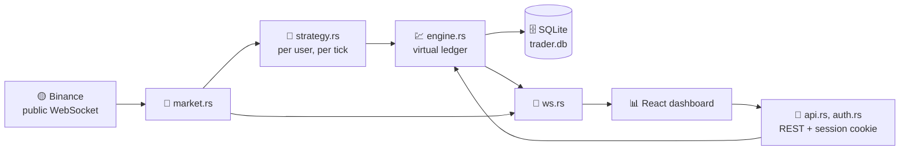

# 📈 Virtual HFT Trading Desk


-003B57?logo=sqlite&logoColor=white)


**A paper-trading desk fed by live Binance prices.** A Rust engine streams public Binance market data, runs a rule-based scalping bot against a virtual $10,000 USDT account, and shows everything on a live React dashboard. You can also place manual virtual trades.

> 🛡️ **Nothing here touches a real exchange account or real money.** No API key is used or needed. All fills are simulated locally at the observed price, with **no fees and no slippage**, so results are optimistic compared with real trading and should not be read as a performance forecast. The strategy has not been backtested.

---

## ✨ Features

| | Feature |
|---|---|
| 📡 | **Live market data.** Public Binance `bookTicker` and `trade` streams for 10 USDT pairs: BTC, ETH, BNB, SOL, XRP, ADA, DOGE, LTC, AVAX and LINK. No key needed. |
| 🤖 | **Scalping bot.** EMA 5/20 crossover, confirmed by order-book imbalance and an RSI band, gated by a maximum spread. Take-profit, stop-loss and trailing stop are sized from ATR. |
| 🧰 | **Tunable strategy.** Change EMA, RSI and ATR periods, thresholds, position size, cooldowns and exits from the dashboard. Each change is range-checked. |
| 🛑 | **Risk controls.** Maximum concurrent positions, maximum exposure, and a daily-loss kill switch that halts new entries until you turn the bot back on. |
| ✋ | **Manual trades.** Buy and sell from the dashboard. The bot manages your manual positions with the same exits. |
| 💹 | **Virtual ledger.** Cash, positions, realized and unrealized P&L, gross profit and loss, win rate, drawdown, and per-symbol stats. Long-only and spot-style, with no shorting or margin. |
| 👥 | **Multi-user.** Each login gets its own isolated account, bot and strategy settings. Accounts are created by an admin command, with no public sign-up. |
| 📊 | **Live dashboard.** Stat tiles, equity curve, price ticker with sparklines, positions and trades tables, symbol selector and bot controls, all updated over WebSocket. |

---

## 🗺️ How it works



Exits are never blocked by the bot switch. Turning the bot or a symbol off only stops new entries, and open positions keep being managed. [HANDOFF.md](HANDOFF.md) explains this and the other design decisions.

---

## 🚀 Run it

You need **Rust**, and **Node.js** for the frontend.

**1. Create a user** (there is no sign-up page):

```bash
cd backend
cargo run --bin create_user -- you@example.com your-password
```

**2. Start the backend** on `http://localhost:8787`:

```bash
cargo run
```

**3. Start the frontend** on `http://localhost:5173`:

```bash
cd frontend
npm install
npm run dev
```

Open `http://localhost:5173` and sign in. The bot is controlled from the dashboard.

Data is stored in `trader.db` in the folder you run the backend from. The backend allows requests from `http://localhost:5173` only, and the frontend talks to `localhost:8787`, so this setup is for local use.

---

## 🔌 API

All routes except `/api/auth/*` need the session cookie.

| Route | Purpose |
|---|---|
| `POST /api/auth/login`, `POST /api/auth/logout`, `GET /api/auth/me` | Session |
| `GET /api/state` | Portfolio, positions, bot and strategy state |
| `GET /api/trades` | Trade history |
| `POST /api/trade` | Manual trade |
| `POST /api/bot/toggle` | Turn the bot on or off |
| `POST /api/strategy/config` | Patch strategy and risk settings |
| `GET`, `POST /api/symbols` | Which symbols the bot may trade (BTC and ETH by default) |
| `POST /api/reset` | Reset the virtual account to $10,000 |
| `GET /ws` | Live price ticks, fills and portfolio snapshots |

---

## 🗂️ Layout

```
backend/
  src/main.rs        routes, CORS, startup tasks
  src/market.rs      Binance WebSocket client
  src/strategy.rs    signals, exits, config and patch types
  src/engine.rs      virtual ledger and stats
  src/state.rs       global and per-user state
  src/auth.rs        argon2 passwords, session cookies
  src/db.rs          SQLite access
  src/bin/create_user.rs   admin account CLI
  migrations/        schema
frontend/src/        React app and components
HANDOFF.md           design decisions, known issues and what live trading would need
```
